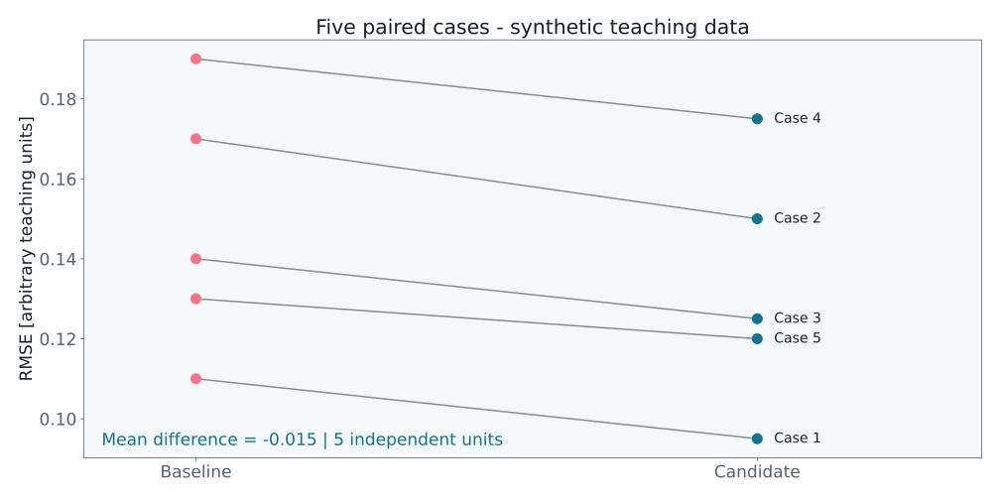

# RFLabs-LEARN

Practical lessons in statistics, machine learning and scientific computing by **Ricardo Fitas**. Each episode is self-contained and comes with reproducible companion material as it becomes available.

**Release cadence:** one LEARN episode every Friday, starting **16 October 2026**. Target release time: **18:00 Europe/London** (the same local time as mainland Portugal).

## Season 1

<!-- EPISODES:START -->
| Episode | Title | Track | Target Friday | YouTube | Materials |
|---|---|---|---|---|---|
| S1E01 | Is Your Model Actually Better? | Statistics | 2026-10-16 | Pending upload | [Code and notebooks](season-1/01-is-your-model-actually-better/) |
| S1E02 | How Much Independent Data Do You Have? | Statistics | 2026-10-23 | Pending upload | In preparation |
| S1E03 | Why Your Test Score Is Too Good | Statistics | 2026-10-30 | Pending upload | In preparation |
| S1E04 | Choose the Right Validation Split | Statistics | 2026-11-06 | Pending upload | In preparation |
| S1E05 | What Does a Confidence Interval Tell You? | Statistics | 2026-11-13 | Pending upload | In preparation |
| S1E06 | Bootstrap for Correlated Data | Statistics | 2026-11-20 | Pending upload | In preparation |
| S1E07 | P-Values, Effect Sizes and Practical Value | Statistics | 2026-11-27 | Pending upload | In preparation |
| S1E08 | Multiple Comparisons and Model Selection | Statistics | 2026-12-04 | Pending upload | In preparation |
| S1E09 | How Many Experiments Do You Need? | Statistics | 2026-12-11 | Pending upload | In preparation |
| S1E10 | Prediction Uncertainty and Calibration | Statistics | 2026-12-18 | Pending upload | In preparation |
| S1E11 | Follow One Training Step | PyTorch + GPU | 2026-12-25 | Pending upload | In preparation |
| S1E12 | Tensors, Shapes and Broadcasting | PyTorch + GPU | 2027-01-01 | Pending upload | In preparation |
| S1E13 | Autograd, Visualized | PyTorch + GPU | 2027-01-08 | Pending upload | In preparation |
| S1E14 | Losses, Optimization and Adam | PyTorch + GPU | 2027-01-15 | Pending upload | In preparation |
| S1E15 | Why Is My GPU Slower Than My CPU? | PyTorch + GPU | 2027-01-22 | Pending upload | In preparation |
| S1E16 | Benchmark CPU and CUDA Correctly | PyTorch + GPU | 2027-01-29 | Pending upload | In preparation |
| S1E17 | Where Did My GPU Memory Go? | PyTorch + GPU | 2027-02-05 | Pending upload | In preparation |
| S1E18 | Find the Bottleneck Before Optimizing | PyTorch + GPU | 2027-02-12 | Pending upload | In preparation |
| S1E19 | Batch Size: Speed, Memory and Learning | PyTorch + GPU | 2027-02-19 | Pending upload | In preparation |
| S1E20 | Does Mixed Precision Change the Answer? | PyTorch + GPU | 2027-02-26 | Pending upload | In preparation |
| S1E21 | Tokens and Embeddings | LLMs | 2027-03-05 | Pending upload | In preparation |
| S1E22 | Self-Attention, Step by Step | LLMs | 2027-03-12 | Pending upload | In preparation |
| S1E23 | Build a Small Transformer in PyTorch | LLMs | 2027-03-19 | Pending upload | In preparation |
| S1E24 | Train a Small Language Model | LLMs | 2027-03-26 | Pending upload | In preparation |
| S1E25 | Generation, Sampling and the KV Cache | LLMs | 2027-04-02 | Pending upload | In preparation |
| S1E26 | Fine-Tuning, RAG and Evaluation | LLMs | 2027-04-09 | Pending upload | In preparation |
| S1E27 | When Does Physics Help Machine Learning? | Scientific ML | 2027-04-16 | Pending upload | In preparation |
| S1E28 | PINN Residuals and Their Scaling | Scientific ML | 2027-04-23 | Pending upload | In preparation |
| S1E29 | Graph Message Passing for Physical Data | Scientific ML | 2027-04-30 | Pending upload | In preparation |
| S1E30 | Small Data, Gaussian Processes and Active Learning | Scientific ML | 2027-05-07 | Pending upload | In preparation |
<!-- EPISODES:END -->

Dates are editorial targets. The YouTube column will link to each actual upload when its URL is available. Publication of later episodes depends on completion and Ricardo's approval. The channel connection is still required to create YouTube schedules; no upload has been represented as scheduled or published.

The machine-readable calendar is [season-1/episodes.json](season-1/episodes.json).

## Start with episode 1

**[Is Your Model Actually Better?](season-1/01-is-your-model-actually-better/)**

Compare two predictors in a simple metal-bar tensile-test setting. Work through paired RMSE differences, a paired percentile bootstrap, an exact sign-flip test and the consequences of treating correlated frames as independent cases. All numerical scores are **synthetic teaching data**; the lesson does not train a model or report experimental metal-test results.

The episode folder includes eight notebooks, the equivalent scripts, pinned Python requirements, deterministic input generation, the case-level CSV, SVG figures and a recorded execution receipt.

### Run the example

Requires Python 3.12 or newer. Open a terminal in the episode folder:

```sh
cd season-1/01-is-your-model-actually-better
python -m pip install -r requirements.txt
python worked_example.py
```

For virtual-environment instructions on Windows, macOS and Linux, see the [episode README](season-1/01-is-your-model-actually-better/README.md). Animated demonstrations additionally require FFmpeg on your PATH. JupyterLab is optional.

### Reproduced results

| Quantity | Value |
|---|---:|
| Independent synthetic cases | 5 |
| Mean baseline case RMSE | 0.148 |
| Mean candidate case RMSE | 0.133 |
| Mean paired difference (candidate − baseline) | −0.015 |
| Paired percentile bootstrap interval | [−0.018, −0.012] |
| Exact sign assignments | 32 |
| Two-sided sign-flip p-value | 0.0625 |



Five cases do not establish reliable population coverage or deployment performance. More resampling or repeated frames do not create additional independent specimens. See the episode's interpretation notes and [execution receipt](season-1/01-is-your-model-actually-better/assets/lesson/execution_receipt.json).

## Reuse

The companion software is provided under the repository's [MIT License](LICENSE). Third-party dependencies retain their own licences.
